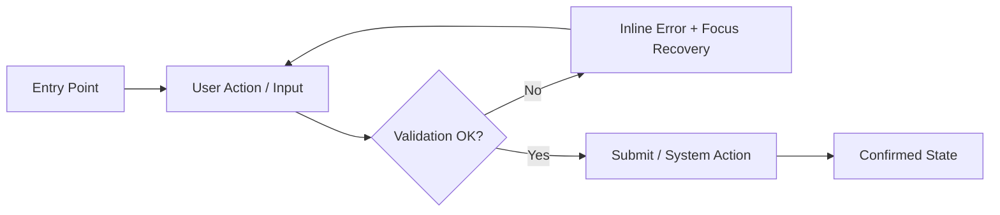

# Design Handoff & Product Decision Log Template

<!-- pdi-handoff: {"feature":"","version":"1.0.0","mode":"solo|team|enterprise","form_factor":"web|mobile|desktop|tablet|wearable|hmi","ui_kit":"shadcn|nuxt-ui|apple-hig|material-3|custom","status":"draft|in-review|approved"} -->

> **Multi-Audience Guide:**
> - **Stakeholders / Non-Product / Non-Engineers:** Read **Section 1 (Executive Summary)** and **Section 7 (Decision Changelog)**.
> - **Product Designers & UX Researchers:** Read **Section 2 (IA & User Flows)**, **Section 3 (State Logic)**, and **Section 4 (UI Copy Glossary)**.
> - **Engineers & AI Coding Agents:** Read **Section 3 (State Logic)**, **Section 5 (UI Kit & Component Mapping)**, and **Section 6 (Acceptance Criteria & Edge Cases)**.

---

## 1. Executive Summary (For All Readers & Non-Technical Stakeholders)
- **Feature / Initiative Name:**
- **User Problem & Goal:** What user problem are we solving and why does it matter now?
- **Business Outcome / Success Metric:** How will we observe whether this succeeded?
- **Operating Mode & Scope Context:** (`solo` | `team` | `enterprise` — state which stages are in scope and which roles/teams own adjacent parts)
- **Target Form Factor & Physical Environment:** (`web` | `mobile` | `desktop` | `tablet` | `wearable` | `hmi` — state viewing distance, attention budget, and input modalities such as touch, pointer, rotary, voice, or gloved hands)
- **Design Restraint & "Why Not No-Redesign?" Check:** Explain why a UI/flow change is warranted over a simpler copy/default change, and what unnecessary elements were intentionally left out.
- **What Changed at a Glance:** Plain-language summary of what users can now do.
- **Current Limitations / Out of Scope:** Explicitly list simulated behaviors, unimplemented backends, or deferred features.

---

## 2. Information Architecture (IA) & User Flows (For Designers, PMs & AI)

### 2.1 Information Architecture & Navigation Hierarchy
```text
[Root / App Shell]
 └── [Primary Section / Route]
      ├── [View / Screen A] (Entry point)
      ├── [View / Screen B] (Primary task)
      └── [Modal / Drawer / Sub-route] (Secondary / confirmation action)
```
- **Page / Screen Hierarchy (H1 → H2 → H3):**
- **Content Priority (Top-to-Bottom / Reading Order):**
  1. Primary decision / status
  2. Core task controls
  3. Secondary actions / metadata

### 2.2 End-to-End Task Flow (Mermaid)


---

## 3. State Logic & Interaction Matrix (For Designers, Engineers & AI)

Specify every state and transition so neither engineers nor AI agents have to guess:

| State | Trigger / Condition | Visible UI & Layout Behavior | Exact UI Copy / Message | Keyboard, Focus & ARIA Contract | Next State / Recovery Action |
|---|---|---|---|---|---|
| **Empty (First-run)** | `items.length === 0` | Show empty state container with primary CTA | Heading + 1-sentence guidance + specific CTA | Focus lands on primary CTA in tab order | Opens creation flow |
| **Default (Loaded)** | Valid data present | Standard layout using unmodified UI kit primitives | Task-specific headings and labels | Logical tab order; visible `:focus-visible` ring | User initiates action |
| **Loading / Pending** | Async request in flight | Disable duplicate submit; show spinner/skeleton inside control | Button label updates (e.g., `Saving...`) | `aria-busy="true"`, keep focus on triggering control | Transitions to Success or Failure |
| **Validation Error** | Invalid/missing user input on blur or submit | Highlight invalid field using UI kit `destructive`/`error` state | Specific cause + how to fix (no vague "Invalid input") | `aria-invalid="true"`, `aria-describedby` linked to error ID; move focus to first invalid field | User edits field; error clears on valid input |
| **System / Network Failure** | API 4xx/5xx or offline | Preserve all user-entered data; show inline alert/banner | Plain explanation + retry action (no "Oops") | `role="alert"` or `aria-live="assertive"` | Retry without re-typing data |
| **Success / Completed** | Confirmed backend response (or explicit prototype state) | Update view or show non-blocking confirmation | Matches trigger verb (e.g., `Save` → `Changes saved`) | `aria-live="polite"`; move focus to logical next heading/control | Returns to updated Default state |
| **Cancelled / Back** | User clicks Back / Cancel / Esc | Return to previous step; retain unsaved multi-step inputs | Confirm discard only if destructive loss of work | `Escape` closes modal and restores focus to trigger button | Previous step restored |

---

## 4. UI Copy & Terminology Glossary (`ux-writing`)
Keep nouns and verbs identical across navigation, headings, buttons, and status messages:

| Concept / Object | Approved Term | Avoid / Deprecated Synonyms | Trigger Button Label | Completion / Toast Text |
|---|---|---|---|---|
| Example: Team container | `Workspace` | `Organization`, `Tenant`, `Project` | `Create workspace` | `Workspace created` |

---

## 5. UI Kit & Component Mapping Contract (`design-system` & `ui-prototyping`)

> **Strict UI Kit Reuse Rule:** Use the project's chosen UI kit components, variants, and semantic tokens **as-is (unmodified)** by default. Do NOT invent custom CSS wrappers, override standard padding/radii, or build bespoke components when a native UI kit component exists. Any modification requires explicit user feedback or a documented gap below.

- **Selected UI Kit Baseline:** (`shadcn/ui` | `Nuxt UI` | `Apple HIG (iOS/macOS)` | `Google Material Design 3 (Android)` | `Custom Token System`)
- **Theme / Token Mode:** (Light / Dark / High-Contrast support)

| UI Element / Screen Region | Native UI Kit Component & Variant | Props / State Configuration | Unmodified Kit Default? | Justification (REQUIRED if Modified or Custom) |
|---|---|---|---|---|
| Primary action button | e.g., `<Button variant="default">` / `<UButton color="primary">` / `UIButton.Configuration.filled()` / `FilledButton` | `type="submit"`, `:loading` | Yes | Uses standard kit component without style overrides |
| Destructive confirmation | e.g., `<AlertDialog>` / `<UModal>` / `UIAlertController` / `AlertDialog` | `variant="destructive"` | Yes | Standard accessible modal/dialog contract |

---

## 6. Engineering Acceptance Criteria & Validation Evidence

### 6.1 Observable Acceptance Criteria
- [ ] **AC-1 (Main Flow):** When [user condition], performing [action] results in [observable outcome].
- [ ] **AC-2 (Validation & Recovery):** Submitting invalid/empty [field] prevents submission, preserves other inputs, moves focus to [field], and announces [exact error copy].
- [ ] **AC-3 (UI Kit Fidelity):** All components use the declared UI kit primitives and semantic tokens without arbitrary magic hex/pixel overrides.
- [ ] **AC-4 (Responsive & Keyboard):** Usable at mobile (`320px–375px`) and desktop (`1280px+`) widths; full flow completable via keyboard (`Tab`, `Shift+Tab`, `Enter`, `Space`, `Escape`).

### 6.2 Validation Performed, 13 Quality Gates & Unverified Gaps
- **13 Design Quality Gates Check:** (Confirm pass/revisions across Problem Fit, Task Effectiveness, Efficiency, IA, Visual Craft, Content Clarity, Accessibility, Platform Fit, Feasibility, System Consistency, Restraint, Safety/Recovery, and Business Relevance)
- **Key Trade-Offs Resolved:** (e.g., *Simplicity vs. Discoverability*, *Minimalism vs. Information Density*, *Speed vs. Safety*, *User Control vs. Automation*)
- **Verified (Executed Checks):** (e.g., `python3 scripts/audit_artifact.py`, DOM state tests, browser viewport inspection)
- **Not Verified / Human Review Needed:** (e.g., real screen reader testing, clinical/industrial human-factors validation, live backend API integration)

---

## 7. Product Decision Log & Changelog (Audit Trail for AI, Designers, PMs & Stakeholders)

Record every product and design decision, why it was made, what alternatives were rejected, and when a decision changes based on user feedback or research:

| Date / Version | Decision ID | Stage / Skill | What Changed & Why (Rationale) | Evidence Tag (`user-provided` \| `verified` \| `assumption` \| `hypothesis`) | Alternatives Rejected | Owner / Approved By |
|---|---|---|---|---|---|---|
| `YYYY-MM-DD` `v1.0` | `DEC-01` | `product-framing` | Defined core problem and scoped out [X] to reduce setup friction | `user-provided` / `assumption` | Full multi-page wizard rejected due to drop-off risk | |
| `YYYY-MM-DD` `v1.0` | `DEC-02` | `design-system` | Adopted stock [UI Kit] components without custom CSS overrides | `verified` | Custom card/button styling rejected to preserve system consistency | |
| `YYYY-MM-DD` `v1.1` | `CHG-01` | `ux-audit` / Revision | Updated [Component/Flow] after user feedback: [describe exact delta] | `user-provided` | | |
